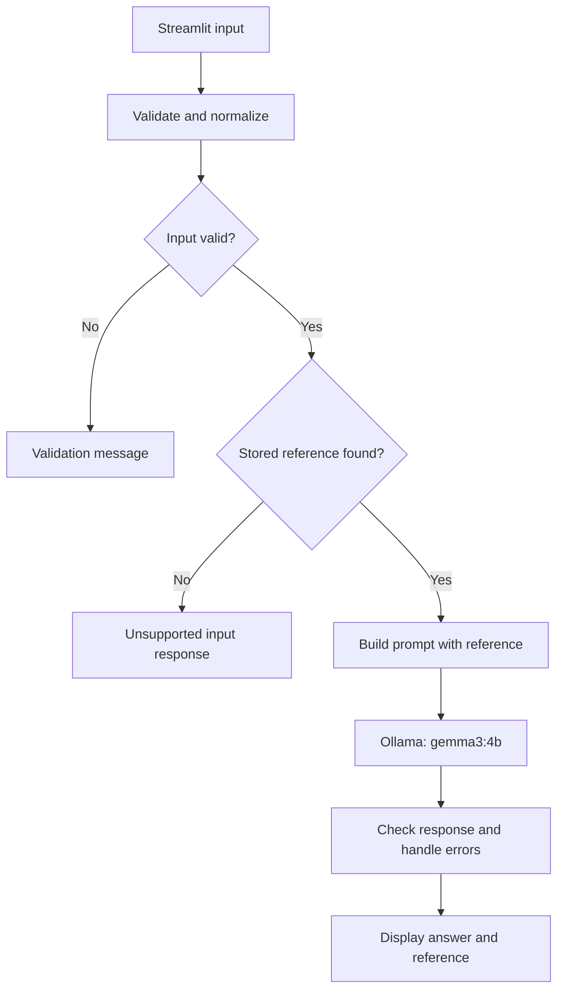

# Banking Payment Operations AI Assistant

A local AI application that explains selected ACH return codes and
an international wire delay topic using stored public-reference summaries.

Built as a CAP 942 AI Application Development capstone project.

## Problem and Purpose

Payment operations teams work with return codes and payment terminology
that can require time to understand.

This application provides structured explanations for payment operations
analysts, support staff, developers, QA engineers, and learners.

It is an educational reference tool. It does not access bank accounts,
execute payments, or verify actual transactions.

## Current MVP Features

- Streamlit interface with ACH and Wire selection
- ACH reference coverage for R01, R02, R03, and R04
- One Wire topic: international wire delays
- Local model inference through Ollama using gemma3:4b
- Structured responses with four sections:
  1. What is known
  2. Possible causes
  3. What to check next
  4. What is unknown
- Reference text and source links
- Empty-input validation
- Case normalization and trimming of surrounding spaces
- A 20-character ACH input limit
- Predefined uncertainty response for unsupported ACH codes
- Handling for connection failures, missing models, timeouts,
  empty responses, and unexpected errors

## Technology Stack

| Technology | Purpose |
|---|---|
| Python | Application logic |
| Streamlit | Browser interface |
| Ollama | Local model runner |
| gemma3:4b | Local language model |
| Ollama Python package | Communication with Ollama |
| HTTPX | Timeout exception handling |
| Python logging | Error diagnostics |

No paid inference API is used.

## Application Workflow

Supported inputs follow this workflow:

1. The user selects ACH or Wire.
2. The user enters an ACH code or selects a Wire topic.
3. The application validates and normalizes the input.
4. It looks up the matching stored reference.
5. The prompt builder adds the reference and response instructions.
6. The LLM service sends the prompt to Ollama.
7. The model generates an explanation.
8. The service checks and trims the response.
9. Streamlit displays the answer and reference panel.

Empty or overlength ACH input is rejected before a model call.
Unsupported ACH codes receive a predefined response without calling
the model.



## Project Files

| File | Responsibility |
|---|---|
| app.py | Streamlit interface, forms, output, and source display |
| assistant_service.py | Input checks, reference lookup, and workflow coordination |
| references.py | Stored ACH and Wire reference text and Wire source metadata |
| prompts.py | Structured prompt and grounding instructions |
| llm_service.py | Ollama requests, response checks, and error handling |
| docs/test_cases.md | Manual test methods, results, and testing limitations |
| implementation_plan.md | Original development roadmap |

Keep the implementation plan in the repository as the original proposal.
This README describes the current, narrower MVP.

## Prerequisites

- Python 3.12 recommended
- Ollama installed
- gemma3:4b downloaded in Ollama
- A browser
- Enough memory and disk space to run the model

The development environment uses Windows, VS Code, PowerShell,
and a Python virtual environment.

## Setup on Windows

### 1. Open the project folder

Open the project in VS Code, then open a PowerShell terminal
in the folder containing app.py.

### 2. Create a virtual environment

For a new setup:

```powershell
python -m venv .venv
```

If the virtual environment already exists, reuse it.

### 3. Install Python dependencies

```powershell
.\.venv\Scripts\python.exe -m pip install -r requirements.txt
```

### 4. Download the model

```powershell
ollama pull gemma3:4b
```

Open the Ollama application and keep it running.

The application connects to:

```text
http://localhost:11434
```

## Run the Application

From the project folder:

```powershell
.\.venv\Scripts\python.exe -m streamlit run app.py
```

Open the Local URL printed in the terminal, normally:

```text
http://localhost:8501
```

Keep the terminal running while using the app.
Press Ctrl+C in that terminal to stop Streamlit.

### Optional: Activate the Virtual Environment

```powershell
.\.venv\Scripts\Activate.ps1
```

After activation:

```powershell
python -m streamlit run app.py
```

The command using the full virtual-environment Python path works
without activation.

## Using the Application

### ACH

1. Select ACH.
2. Enter a supported code, such as R01.
3. Click Explain code.
4. Review the four answer sections.
5. Expand View reference used to inspect the stored reference
   and source link.

Lowercase input such as r01 is normalized to R01.

### Wire

1. Select Wire.
2. Select INTERNATIONAL WIRE DELAY.
3. Click Explain topic.
4. Review possible delay factors and suggested verification.
5. Expand View reference used.

The Wire feature is a topic lookup. It does not check a real
wire transfer's status.

## Example Inputs and Expected Behavior

| Input | Expected behavior |
|---|---|
| ACH: R01 | Explain using the stored R01 reference |
| ACH: R02 | Explain using the stored R02 reference |
| ACH: R03 | Explain using the stored R03 reference |
| ACH: R04 | Explain using the stored R04 reference |
| ACH: r01 | Normalize to R01 and use its reference |
| ACH: XYZ123 | State that the reference does not cover the code |
| Empty ACH input | Ask the user to enter an ACH return code |
| ACH input longer than 20 characters | Reject direct service input; the UI limits entry to 20 characters |
| Wire: INTERNATIONAL WIRE DELAY | Explain reference delay factors as possibilities |

Model-generated wording can vary between requests.

## Reference Sources and Grounding

ACH reference definitions are adapted from:

- [Northern Trust — ACH Return Code Reference](https://web-xp2i-pws.ntrs.com/online_support/inforpt/ach_return_codes.htm)

The Wire summary is adapted from Bank of America's international
wire guidance. Its source title and URL are stored in references.py
and displayed in the Wire reference panel.

The application uses stored local reference text. It does not fetch
these websites during a request.

The prompt instructs the model to:

- Use only the supplied reference for factual explanations.
- Copy the reference in What is known.
- Avoid unsupported causes and invented transaction details.
- State uncertainty.
- Label investigation guidance as a suggested check.
- Avoid treating a lookup as evidence about an actual transaction.

Prompt instructions reduce unsupported output but do not guarantee
correctness.

## Current Grounding Approach

The MVP uses an exact code or topic lookup to select reference text
and include it in the prompt.

It does not currently use:

- PDF ingestion
- Document chunking
- Embeddings
- ChromaDB
- Semantic search

Document retrieval with embeddings and a vector database is an
optional future enhancement.

## Error Handling

| Condition | Application behavior |
|---|---|
| Ollama unavailable | Ask the user to open Ollama and retry |
| Model not found | Show the model name and a model-download command |
| Request timeout | Display a retry message |
| Empty model response | Display an empty-response fallback |
| Other Ollama error | Display a friendly message and log details |
| Unexpected exception | Display a friendly message and log details |

Normal configuration in llm_service.py:

```python
MODEL_NAME = "gemma3:4b"
```

```python
client = Client(
    host="http://localhost:11434",
    timeout=120.0,
)
```

## Testing

Manual tests completed include:

- R01, R02, R03, and R04
- International wire delay topic
- Lowercase ACH input
- Unknown ACH code
- Empty ACH input
- UI and service input-length limits
- Missing-model handling and recovery
- Ollama connection failure and recovery
- Timeout handling and recovery
- Simulated empty-response handling and recovery
- ACH source display and usage notice

Detailed results are recorded in
[docs/test_cases.md](docs/test_cases.md).

An automated pytest suite has not yet been run.
Unexpected exceptions and non-404 Ollama errors have handlers,
but were not simulated.

### Direct Service Length Check

Run:

```powershell
.\.venv\Scripts\python.exe -c "from assistant_service import get_answer; print(get_answer('ABCDEFGHIJKLMNOPQRSTU'))"
```

Expected output:

```text
Please enter an ACH return code of 20 characters or fewer.
```

## Troubleshooting

### Cannot connect to Ollama

Open Ollama from the Windows Start menu, then retry.

### Model could not be found

Confirm the model setting is gemma3:4b, then run:

```powershell
ollama pull gemma3:4b
```

### The model took too long to respond

Confirm timeout is restored to 120.0.
Retry after allowing the model to load.

### Streamlit does not launch

Confirm the terminal is in the folder containing app.py
and use:

```powershell
.\.venv\Scripts\python.exe -m streamlit run app.py
```

### After restarting the computer

Open Ollama, open a terminal in the project folder,
and run the Streamlit command again.

## Responsible Use and Privacy

Do not enter:

- Account numbers
- Customer personal information
- Credentials
- Confidential banking information
- Production logs containing sensitive data

Use public reference material and synthetic examples.

AI explanations may be incomplete or incorrect. Verify operational
guidance against official documentation and authorized review.

The app does not execute payments, recommend automatic payment
repair, or verify real transactions.

## Limitations

- ACH coverage is limited to R01 through R04.
- Wire coverage is limited to one international delay topic.
- Free-form payment questions and status lookups are not supported.
- Reference summaries are maintained manually and may become outdated.
- The model may fail to follow instructions.
- The app has no access to internal bank procedures or live records.
- Local response speed depends on available hardware.
- The current MVP has no authentication or banking integrations.

## Challenges and Lessons Learned

- Separate modules made UI, prompting, references, and model calls
  easier to understand and maintain.
- Narrow prompts and supplied references helped limit unsupported
  explanations.
- Unknown codes needed an explicit fallback.
- Local model calls required connection, timeout, and missing-model
  handling.
- Recovery checks confirmed normal operation after temporary failures.
- Manual review compared generated explanations with their references.

## Future Enhancements

- Add more reviewed ACH references and Wire topics.
- Add automated tests for deterministic logic.
- Improve visual presentation of model errors.
- Add document ingestion, chunking, embeddings, and retrieval.
- Evaluate retrieved context and answer quality.
- Explore selected ISO 20022 concepts within a limited scope.