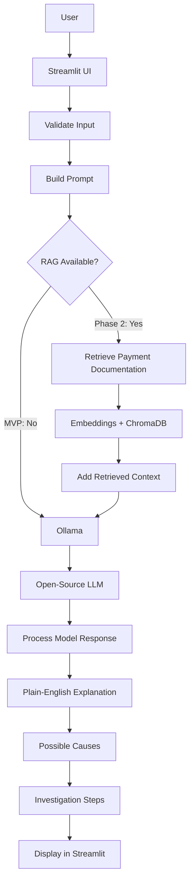

# CAP 942 AI Application Development Capstone
# Implementation Plan

## 1. Project Title

**Banking Payment Operations AI Assistant**  
*AI-Powered ACH & Wire Knowledge and Troubleshooting Assistant*

---

## 2. Project Summary

The Banking Payment Operations AI Assistant is a small AI-powered application that helps users understand ACH and wire payment return codes, transaction statuses, payment errors, and common operational issues. A user will select a payment type and enter a payment-related question, status, return code, or issue description through a Streamlit interface. The application will send a structured prompt to a locally running open-source LLM through Ollama and display a clear response containing a plain-English explanation, possible causes, suggested investigation steps, and what the user should verify next. After the core MVP works reliably, the project may be enhanced with Retrieval-Augmented Generation (RAG) so that answers can be grounded in selected public payment documentation.

**Value proposition:** Help payment operations and technical-support users understand banking payment issues faster by turning complex ACH and wire terminology into clear, structured explanations.

---

## 3. Problem Statement

### Problem Being Addressed

Banking payment operations involve return codes, transaction statuses, processing terminology, and exception scenarios that can be difficult to understand quickly. When a payment fails, is returned, or remains in an unexpected status, payment operations staff, support teams, developers, QA engineers, or new employees may need to search documentation or ask experienced team members to determine what the issue means and what should be investigated next.

### Why It Matters

Payment-related issues need to be investigated accurately and efficiently. Making operational knowledge easier to access can reduce time spent searching for information and help users understand payment-processing concepts more consistently.

### Intended Users

- Payment operations analysts
- Banking support teams
- Technical support engineers
- Developers and QA engineers working with payment applications
- New employees learning ACH and wire payment operations

The application is intended as an educational and operational-support tool. It will not execute payments, access bank accounts, make financial decisions, or replace official banking/payment-network documentation.

---

## 4. Capstone Requirement Alignment

| Capstone Requirement | How the Application Will Meet It | Evidence / Deliverable |
|---|---|---|
| Use one open-source LLM | An open-source instruction model will run locally through Ollama | Model name and setup documented in README |
| Accept user input | Streamlit will accept payment type plus a return code, status, question, or issue description | Live application demo |
| Produce LLM-generated output | The LLM will generate a structured explanation and investigation guidance | Example outputs and live demo |
| Use an approved application format | The project will be a Streamlit web application | Working `streamlit run` workflow |
| No paid APIs | Ollama and the selected model will run locally | README setup instructions |
| Solve a clear problem | The assistant will help users understand ACH and wire payment issues | Proposal and presentation |
| Demonstrate workflow design | The project will use separate validation, prompt, LLM, and response-processing steps | Architecture and workflow diagram |
| Demonstrate prompt engineering | Prompts will require consistent sections, uncertainty handling, and verification language | Prompt template and test examples |
| Run end-to-end | Input → processing → LLM → output will work in one application | Functional application |
| Include clear documentation | README and supporting project documentation will cover setup, architecture, workflow, limitations, and testing | GitHub repository |
| Include workflow diagram | Mermaid diagram will show user input, Streamlit, Python processing, Ollama, LLM, and optional RAG | Documentation and presentation |
| Appropriate scope | ACH + Wire explanation will be the required MVP; RAG and international payments will be optional | Scope section and milestone plan |
| Data/input sources if applicable | Optional RAG phase will use public payment documentation and synthetic examples | Data Sources section |
| 5–10 minute presentation | Presentation will include problem, solution, tools, workflow, demo, lessons, and next steps | Final presentation |

---

## 5. Project Scope

### Minimum Viable Product Features

The MVP will include:

1. Streamlit web interface
2. Payment type selection:
   - ACH
   - Wire
3. Text input for:
   - Return code
   - Transaction status
   - Error message
   - Payment-related question
4. Input validation
5. Reusable prompt-building logic
6. Local LLM call through Ollama
7. Structured AI response containing:
   - Plain-English explanation
   - Important details
   - Possible causes
   - Suggested investigation steps
   - What to check next
   - Verification notice
8. Basic error handling
9. Realistic test cases
10. README and workflow documentation

### Features Outside the Initial Scope

The MVP will not include:

- Live banking-system integrations
- Real customer or production transaction data
- Payment execution or repair
- Credit card transactions
- Check processing
- Fraud scoring
- User authentication
- Multiple models
- Multi-agent workflows
- Cloud services requiring payment
- Full ISO 20022 message parsing

### Optional Enhancements After MVP

#### Phase 2 — Payment Documentation RAG

- Load a small set of public ACH/wire reference documents
- Extract text from PDF or text sources
- Split documents into chunks
- Create embeddings
- Store embeddings in ChromaDB
- Retrieve relevant document chunks
- Send retrieved context to the LLM
- Display source/context information

#### Phase 3 — International Payment Enhancement

- Add international-payment questions
- Introduce selected ISO 20022 terminology
- Support a few synthetic international-payment scenarios
- Expand testing
- Improve UI and source display

---

## 6. Recommended Technology Stack

### Current Experience Level

**Intermediate software developer; beginner-to-intermediate in Python AI application development.**

This plan assumes strong general programming experience while introducing Python LLM application development incrementally.

### Development Environment

- **Operating system:** Windows
- **Editor:** VS Code
- **RAM:** To be confirmed
- **Fallback environment:** Google Colab if local model performance is not practical

### Recommended Stack

| Technology | Role | Why It Fits |
|---|---|---|
| Python | Main application language | CAP 942 recommended language and strong AI ecosystem |
| `uv` | Project/dependency management | Fast, simple environment and dependency management |
| Streamlit | User interface | Quick to learn and ideal for a 10–15 day AI capstone |
| Ollama | Local model runner | Runs open-source LLMs without a paid API |
| Small open-source instruct LLM | AI generation | Good for explanations and structured responses |
| Ollama Python package or `requests` | Python-to-Ollama communication | Simple local model integration |
| pytest | Unit/component testing | Lightweight testing for deterministic Python logic |
| Git/GitHub | Version control and submission | Required for project delivery and documentation |
| pypdf | Phase 2 PDF processing | Simple PDF text extraction |
| LangChain | Phase 2 orchestration | Helpful for loaders, text splitting, retrieval, and RAG |
| ChromaDB | Phase 2 vector database | Local, beginner-friendly vector storage |
| SentenceTransformers or compatible embedding model | Phase 2 embeddings | Converts text chunks into searchable vectors |

### Open-Source LLM Choice

Start with a **3B–4B instruct model available through Ollama**. The final model should be selected after checking available RAM and testing response quality.

If the computer has enough RAM and performance is acceptable, a 7B-class model may be tested.

### Hardware Considerations

CAP 942 notes that local-model requirements vary and recommends at least 16 GB RAM, with 32 GB preferred.

If local performance is limited:

- Use a smaller 3B-class model
- Keep prompts concise
- Limit context length
- Close unnecessary applications
- Use a free notebook environment such as Google Colab if needed

The MVP should not depend on a GPU.

---

## 7. Application Workflow

### MVP Flow

1. User opens the Streamlit application.
2. User selects ACH or Wire.
3. User enters a payment issue, return code, status, or question.
4. Python validates the input.
5. The prompt builder creates clear instructions for the model.
6. Python sends the prompt to Ollama.
7. Ollama runs the selected open-source LLM locally.
8. The LLM generates a structured response.
9. Python validates/cleans the response.
10. Streamlit displays the result.
11. The application reminds the user to verify important operational guidance against official documentation.

### Phase 2 RAG Flow

1. Public payment reference documents are loaded.
2. Text is extracted.
3. Documents are divided into smaller chunks.
4. Embeddings are created for each chunk.
5. Chunks and embeddings are stored in ChromaDB.
6. User asks a question.
7. Similar document chunks are retrieved.
8. Retrieved context is added to the prompt.
9. Ollama/LLM produces an answer grounded in that context.
10. The answer and relevant source information are displayed.

### Mermaid Workflow Diagram



**Where the open-source LLM is used:** Ollama runs the selected LLM after the application prepares the prompt and, in Phase 2, after relevant document context has been retrieved.

---

## 8. Application Architecture

### Component 1 — Streamlit UI

**Responsibility**
- Collect payment type and user question
- Trigger analysis
- Display errors and results

### Component 2 — Input Validator

**Responsibility**
- Reject empty input
- Check input length
- Ensure required values are present

### Component 3 — Prompt Builder

**Responsibility**
- Convert user input into a consistent prompt
- Define required response sections
- Add responsible-AI instructions

### Component 4 — LLM Service

**Responsibility**
- Communicate with Ollama
- Send prompt/model name
- Receive generated response
- Handle model/network errors

### Component 5 — Response Processor

**Responsibility**
- Detect empty responses
- Clean response text
- Prepare output for UI display

### Component 6 — Optional RAG Layer

**Responsibility**
- Load documents
- Split documents into chunks
- Generate embeddings
- Store/retrieve vectors
- Provide context for the LLM

### Information Flow

```text
User
  ↓
Streamlit
  ↓
Validation
  ↓
Prompt Builder
  ↓
[Optional Retrieval]
  ↓
Ollama
  ↓
Open-Source LLM
  ↓
Response Processor
  ↓
Streamlit Output
```

### Error Handling

Errors should be handled:

- Before an empty/invalid input reaches the model
- When Ollama is not running
- When the model name is incorrect
- When the model times out
- When a model response is empty
- When a Phase 2 document cannot be loaded
- When retrieval returns no useful context

Users should see understandable messages rather than Python stack traces.

---

## 9. Proposed Project Structure

```text
banking-payment-ai-assistant/
│
├── README.md
├── implementation_plan.md
├── pyproject.toml
├── .gitignore
│
├── app.py
│
├── src/
│   ├── __init__.py
│   ├── validation.py
│   ├── prompts.py
│   ├── llm_service.py
│   ├── response_processor.py
│   └── rag/
│       ├── __init__.py
│       ├── document_loader.py
│       ├── text_splitter.py
│       └── retriever.py
│
├── data/
│   ├── README.md
│   └── public_reference_docs/
│
├── tests/
│   ├── test_validation.py
│   ├── test_prompts.py
│   └── test_response_processor.py
│
└── docs/
    ├── workflow.md
    ├── architecture.md
    └── test_cases.md
```

### Purpose of Each File

- `README.md` — project overview, setup, execution, examples, architecture, limitations
- `implementation_plan.md` — learning and development roadmap
- `pyproject.toml` — Python dependencies managed by `uv`
- `.gitignore` — excludes temporary/local files
- `app.py` — small Streamlit entry point
- `validation.py` — input checks
- `prompts.py` — prompt templates and builders
- `llm_service.py` — Ollama communication
- `response_processor.py` — output checking/cleanup
- `rag/document_loader.py` — optional Phase 2 document ingestion
- `rag/text_splitter.py` — optional text chunking
- `rag/retriever.py` — optional vector retrieval
- `data/` — only public or synthetic reference material
- `tests/` — deterministic application tests
- `docs/` — supporting project documentation

The completed application files should be written incrementally during development rather than generated all at once.

---

## 10. Step-by-Step Development Milestones

### Milestone 1 — Run a Local Open-Source LLM

**Learning objective**  
Understand how Ollama runs an open-source LLM locally and how Python communicates with it.

**Concepts to review**
- LLM basics
- Inference
- Prompt and response
- Local model execution
- HTTP/API basics

**Development tasks**
- Install Ollama
- Choose a small model
- Run the model from the command line
- Send one test request from Python

**Small coding exercise**  
Write a small function that accepts one question and returns a string that will later become the model prompt.

**Testing checkpoint**  
Ask one simple question unrelated to banking and confirm Python receives a response.

**Acceptance criteria**
- Ollama is installed
- Model runs locally
- Python can communicate with it

**Common mistakes**
- Ollama server not running
- Incorrect model name
- Starting UI development before confirming model connectivity

**What I need to build myself**
- Environment setup
- Model selection
- First Python request

**How I will know it works**
A Python script prints a model-generated response.

---

### Milestone 2 — Design the Banking Prompt

**Learning objective**  
Learn how prompt design affects model behavior.

**Concepts to review**
- System instructions
- Prompt templates
- Structured output
- Hallucination
- Uncertainty

**Development tasks**
- Define supported payment types
- Define user-input fields
- Define required response sections
- Write first payment prompt
- Test ACH and wire scenarios

**Small coding exercise**  
Write a function that receives `payment_type` and `issue_text` and returns a formatted prompt.

**Testing checkpoint**  
Try at least five sample questions and check whether outputs follow the required headings.

**Acceptance criteria**
Most valid responses include:
- Explanation
- Possible causes
- Investigation steps
- Verification notice

**Common mistakes**
- Asking very broad questions
- Allowing the model to invent missing transaction information
- Trying to support too many payment types immediately

**What I need to build myself**
- Final prompt wording
- Payment examples
- Response format

**How I will know it works**
ACH and wire questions generate understandable, structured responses.

---

### Milestone 3 — Separate the Python Components

**Learning objective**  
Learn to build a maintainable AI application instead of placing everything in one file.

**Concepts to review**
- Python functions
- Modules
- Exceptions
- Separation of concerns

**Development tasks**
- Build validation logic
- Build prompt logic
- Build LLM-call logic
- Build response-processing logic

**Small coding exercise**  
Create a validator that returns an error for blank input.

**Testing checkpoint**  
Call each function separately before connecting Streamlit.

**Acceptance criteria**
Each major responsibility is represented by a small reusable function/module.

**Common mistakes**
- Putting all code inside `app.py`
- Catching all exceptions generically
- Mixing UI and LLM logic

**What I need to build myself**
- Function bodies
- Error messages
- Module organization

**How I will know it works**
Each function can be tested independently.

---

### Milestone 4 — Build the Streamlit MVP

**Learning objective**  
Connect the working AI logic to a simple user interface.

**Concepts to review**
- Streamlit input widgets
- Buttons/forms
- Displaying output
- Error messages

**Development tasks**
- Create title/description
- Add payment-type selection
- Add text area
- Add Analyze button
- Validate input
- Call LLM function
- Display formatted response
- Add disclaimer

**Small coding exercise**  
Create a Streamlit page that displays the value selected in a dropdown and text entered in a text area.

**Testing checkpoint**  
Complete one ACH question from browser input to final model output.

**Acceptance criteria**
The application runs end-to-end.

**Common mistakes**
- Calling the model on every UI rerun
- No loading indicator
- Showing raw exceptions to users

**What I need to build myself**
- Streamlit layout
- Button behavior
- Integration code

**How I will know it works**
A user can enter an ACH or wire question and receive a readable response without using the command line.

---

### Milestone 5 — Test and Stabilize the MVP

**Learning objective**  
Learn how to test both normal Python code and non-deterministic LLM behavior.

**Concepts to review**
- Unit tests
- Integration testing
- Error paths
- LLM evaluation

**Development tasks**
- Test validation
- Test prompt generation
- Create manual banking test cases
- Test bad/unknown input
- Test Ollama-offline behavior

**Small coding exercise**  
Create two pytest cases: one for blank input and one for valid input.

**Testing checkpoint**  
Run all tests and document manual LLM evaluation results.

**Acceptance criteria**
MVP is stable enough to demonstrate.

**Common mistakes**
- Testing only successful scenarios
- Expecting identical model wording every time
- Treating a confident answer as necessarily correct

**What I need to build myself**
- Test scenarios
- Expected behaviors
- Evaluation notes

**How I will know it works**
All deterministic tests pass and LLM outputs meet the defined quality criteria.

---

### Milestone 6 — Add RAG Over Payment Documentation

**Learning objective**  
Understand how Retrieval-Augmented Generation grounds an LLM in selected documents.

**Concepts to review**
- PDF/text extraction
- Chunking
- Embeddings
- Semantic search
- Vector databases
- Retrieval-Augmented Generation

**Development tasks**
- Select a small number of public payment documents
- Extract text
- Create chunks
- Generate embeddings
- Store them in ChromaDB
- Retrieve relevant chunks
- Add retrieved content to prompts

**Small coding exercise**  
Take one short text document, split it into several chunks, and print the chunks.

**Testing checkpoint**  
Ask a question whose answer is clearly contained in one document and inspect which chunk is retrieved.

**Acceptance criteria**
A relevant document chunk is retrieved and passed to the LLM.

**Common mistakes**
- Adding too many documents
- Poor chunk sizes
- Believing RAG guarantees accuracy
- Hiding the distinction between retrieved facts and model-generated reasoning

**What I need to build myself**
- Document selection
- Chunking strategy
- Retrieval settings
- RAG prompt integration

**How I will know it works**
Known payment questions retrieve the expected context and produce more grounded answers.

---

### Milestone 7 — Optional International / ISO 20022 Enhancement

**Learning objective**  
Extend a working application safely.

**Concepts to review**
- International-payment basics
- ISO 20022 at a high level
- XML structure if needed

**Development tasks**
- Add one international-payment category
- Create a few synthetic scenarios
- Update prompts
- Update tests

**Small coding exercise**  
Inspect a tiny synthetic XML message and extract two selected fields.

**Testing checkpoint**  
Re-run ACH and Wire tests after the enhancement.

**Acceptance criteria**
The new feature works without breaking the MVP.

**Common mistakes**
- Trying to build a full ISO 20022 parser
- Expanding scope before the MVP/RAG work is stable

**What I need to build myself**
- Exact international scenario
- Fields to explain
- Prompt changes

**How I will know it works**
At least one international-payment example produces a useful explanation and existing features still work.

---

## 11. Guided Code Examples

### Example 1 — Validate User Input

```python
def validate_issue_text(issue_text: str) -> bool:
    # Remove spaces around the input.
    cleaned = issue_text.strip()

    # Do not call the model for empty input.
    if not cleaned:
        return False

    # TODO: Add your own maximum-length rule.
    return True
```

**Explanation:**  
This demonstrates simple validation before an expensive LLM call.

**Practice task:**  
Change the function so it returns a useful error message when the text is too long.

---

### Example 2 — Create a Reusable Prompt Function

```python
def build_prompt(payment_type: str, issue: str) -> str:
    # Keep model instructions separate from UI code.
    prompt = f"""
Payment type: {payment_type}
Issue: {issue}

Explain the payment issue in plain English.
List possible causes.
Suggest investigation steps.

TODO: Add your final verification instruction.
"""
    return prompt.strip()
```

**Explanation:**  
This shows why prompt creation should be reusable instead of hard-coded into the UI.

**Practice task:**  
Add the exact headings you want the model to return.

---

### Example 3 — Call an Open-Source LLM Through Ollama

```python
import requests

def ask_ollama(model: str, prompt: str) -> str:
    # Ollama provides a local HTTP endpoint.
    response = requests.post(
        "http://localhost:11434/api/generate",
        json={
            "model": model,
            "prompt": prompt,
            "stream": False,
        },
        timeout=60,
    )

    response.raise_for_status()

    # TODO: Safely handle a missing "response" value.
    return response.json()["response"]
```

**Explanation:**  
This isolated example demonstrates how Python can communicate with a model running locally through Ollama.

**Practice task:**  
Print the JSON response once and identify which field contains the generated text.

---

### Example 4 — Handle One Common Error

```python
import requests

def run_safely(llm_function):
    try:
        return llm_function()

    except requests.ConnectionError:
        # This can happen if Ollama is not running.
        return "The local AI model is unavailable."

    # TODO: Add separate handling for a timeout.
```

**Explanation:**  
LLM applications should fail gracefully when the model service is unavailable.

**Practice task:**  
Add `requests.Timeout` handling with a different message.

---

## 12. Prompt-Engineering Plan

### Purpose of the System Prompt

The system prompt should define the LLM as a payment-operations knowledge assistant and set clear boundaries.

It should instruct the model to:

- Explain banking-payment terminology simply
- Separate known information from possible causes
- Avoid inventing missing transaction details
- State uncertainty when appropriate
- Provide investigation guidance rather than automatic decisions
- Recommend verification against official payment documentation

### Information the User Will Provide

- Payment type
- Return/status code, if available
- Error/message text
- Short payment question or scenario
- Optional context

### Expected Response Format

1. Plain-English Explanation
2. Important Details
3. Possible Causes
4. Suggested Investigation Steps
5. What to Check Next
6. Verification Notice

### Example Prompt Template

```text
You are a banking payment operations knowledge assistant.

Payment type:
{PAYMENT_TYPE}

User question or issue:
{USER_INPUT}

Provide:
1. Plain-English Explanation
2. Important Details
3. Possible Causes
4. Suggested Investigation Steps
5. What to Check Next
6. Verification Notice

Do not invent payment or customer information.
If the answer is uncertain, say so.
Important operational decisions should be verified using official payment documentation.
```

### Methods for Reducing Unclear or Unsupported Responses

- Give the model a narrow role
- Require structured sections
- Explicitly prohibit invented transaction facts
- Ask the model to state uncertainty
- Keep prompts concise
- Test with ambiguous questions
- Add RAG in Phase 2
- Retrieve only relevant document chunks
- Display source/context when possible

---

## 13. Testing Plan

### Unit / Component Tests

Test deterministic parts of the application:

- Empty input
- Maximum input length
- Payment-type validation
- Prompt formatting
- Empty model-response handling

### End-to-End Testing

Test:

**Streamlit → validation → prompt builder → Ollama → LLM response → Streamlit display**

### Realistic Test Cases

| # | Test Input | Expected Behavior |
|---|---|---|
| 1 | ACH + `R01` | Explain the return code in understandable language and suggest verification/investigation steps |
| 2 | ACH + returned payment description | Provide structured explanation without inventing account/customer details |
| 3 | Wire + “payment is pending longer than expected” | Explain possible delay categories and suggest what should be checked |
| 4 | Empty question | Show validation error and do not call the LLM |
| 5 | Unknown code such as `XYZ123` | State uncertainty instead of confidently inventing a definition |
| 6 | Ollama stopped | Show a friendly model-unavailable message |
| 7 | Extremely long input | Enforce the selected length rule or display a helpful validation message |
| 8 | Phase 2 RAG question with a known answer | Retrieve a relevant chunk and use it in the answer |

### LLM Output Quality Evaluation

Score each response from 1 to 5 for:

- Relevance
- Clarity
- Completeness
- Grounding
- Appropriate uncertainty
- Usefulness of investigation steps

A strong answer should:

- Address the actual question
- Avoid unsupported transaction facts
- Clearly distinguish possibilities from facts
- Use understandable language
- Encourage verification when appropriate

---

## 14. Privacy, Security, Accessibility, and Responsible-AI Considerations

### Risks

- Users could enter sensitive payment/customer information
- LLM may hallucinate a payment rule
- LLM knowledge may be incomplete or outdated
- A model may sound confident even when uncertain

### Privacy Controls

Use only:

- Synthetic payment scenarios
- Public documentation
- Sanitized examples

The UI should remind users not to enter:

- Account numbers
- Customer personal information
- Credentials
- Confidential banking information
- Production logs containing sensitive data

### Security

The project will not:

- Connect to a bank account
- Initiate transactions
- Store payment credentials
- Modify real financial records

### Responsible-AI Controls

- Clear verification disclaimer
- Explicit uncertainty instructions
- No automatic financial/payment decisions
- RAG grounding when implemented
- Realistic manual testing

### Project Limitations

The assistant:

- Is not an authoritative banking rule engine
- May produce incorrect or incomplete explanations
- Does not have access to internal bank procedures
- Does not know the actual state of a real payment
- Should not replace official documentation or experienced review

### Claims the Application Should Not Make

It should not claim:

- A payment will definitely be successful
- A payment should definitely be retried
- A specific institution caused an issue without evidence
- Its answer is official banking guidance
- It has verified a real transaction

### Accessibility

- Clear form labels
- Simple navigation
- Readable headings
- Text-based status/error feedback
- No dependence on color alone
- Concise explanations

---

## 15. Documentation and GitHub Plan

### README Sections

1. Project title
2. Project overview
3. Problem statement
4. Intended users
5. Features
6. MVP scope
7. Optional enhancements
8. Technology stack
9. Application workflow
10. Architecture
11. Installation
12. Ollama/model setup
13. How to run the application
14. Example inputs and outputs
15. Data sources
16. Testing approach
17. Responsible-AI considerations
18. Limitations
19. Challenges and lessons learned
20. Future enhancements

### Setup Documentation

Include:

- Required Python version
- `uv` installation
- Project environment setup
- Dependency installation
- Ollama installation
- Model download
- Streamlit run instructions

### Dependencies

All Python dependencies should be declared in `pyproject.toml`.

### Example Inputs and Outputs

Include at least:

- One ACH example
- One Wire example
- One invalid-input example
- One RAG example if Phase 2 is completed

### GitHub Submission Checklist

- [ ] Repository created
- [ ] README complete
- [ ] `implementation_plan.md` included
- [ ] `pyproject.toml` included
- [ ] `.gitignore` included
- [ ] No secrets committed
- [ ] No confidential payment/customer data
- [ ] Application runs locally
- [ ] Ollama/model instructions documented
- [ ] Example input/output included
- [ ] Workflow diagram included
- [ ] Architecture documented
- [ ] Testing documented
- [ ] Limitations documented
- [ ] Data sources documented if RAG is used

---

## 16. Presentation Plan

Target presentation length: **about 7 minutes**, within the required 5–10 minute range.

### 1. Problem — 45 seconds

Explain in simple language:

Payment operations use return codes, statuses, and technical terminology. Employees may need to search documentation or ask experienced staff to understand an issue.

### 2. Solution — 45 seconds

Introduce the Banking Payment Operations AI Assistant.

Explain:

> A user enters an ACH or wire payment question or issue, and the application uses a local open-source LLM to explain the problem and suggest investigation steps.

### 3. Workflow Diagram — 60 seconds

Show:

```text
User
→ Streamlit
→ Validation / Prompt
→ Ollama
→ Open-Source LLM
→ Structured Answer
```

If RAG is completed:

```text
User
→ Retrieve Relevant Payment Documentation
→ Ollama / LLM
→ Grounded Answer
```

### 4. Live Demo — 2–3 minutes

#### Demo 1
ACH question using a return-code example.

#### Demo 2
Wire-payment issue such as an unexpected pending/delayed status.

#### Optional Demo 3
One RAG question if Phase 2 is complete.

### 5. Technology — 45 seconds

Briefly explain:

- Python
- Streamlit
- Ollama
- Open-source LLM
- LangChain/ChromaDB only if Phase 2 is completed

### 6. Challenges and Lessons Learned — 45 seconds

Potential topics:

- Prompt design
- Local model speed
- Model hallucination
- Input validation
- RAG chunking/retrieval

### 7. Next Steps — 30 seconds

Possible future additions:

- More public reference documents
- International payments
- ISO 20022
- Better source display
- Additional payment categories

---

## 17. Suggested Timeline

This timeline assumes approximately **10–15 development days**.

### Day 1 — Environment + Ollama
- Set up `uv`
- Install Ollama
- Select/test a small model
- Confirm local inference works

### Day 2 — Python + Ollama
- Learn Python model calls
- Test basic prompts
- Create first reusable request function

### Day 3 — Payment Prompt Design
- Define ACH/Wire input
- Create response sections
- Test prompt variations

### Day 4 — Core Python Components
- Validation
- Prompt builder
- LLM service
- Response processing

### Day 5 — Streamlit MVP
- Build the UI
- Connect complete workflow
- Run one full ACH example

**Checkpoint: the first end-to-end MVP must work before continuing.**

### Day 6 — Wire + Error Handling
- Add/test Wire examples
- Add model connection errors
- Improve validation

### Day 7 — MVP Testing and Cleanup
- Add pytest tests
- Test realistic scenarios
- Improve code organization
- Start README

**Checkpoint: MVP should now be presentation-ready.**

### Day 8 — Learn RAG
- Review chunking, embeddings, vector DB, retrieval
- Select a small public-document set

### Day 9 — Document Processing
- Extract text
- Split text
- Inspect chunks

### Day 10 — Embeddings + ChromaDB
- Create embeddings
- Store chunks
- Test retrieval independently

### Day 11 — RAG Integration
- Connect retrieval to prompt
- Test a grounded payment question

### Day 12 — Improve RAG
- Tune retrieval
- Add source/context display
- Handle missing results

### Day 13 — Optional International / ISO 20022
- Add only one small enhancement if MVP + RAG are stable

### Day 14 — Documentation and Testing
- Finalize README
- Finalize workflow/architecture
- Run full test set
- Clean GitHub

### Day 15 — Presentation
- Prepare 5–10 minute presentation
- Practice live demo
- Prepare backup screenshots

---

## 18. Definition of Done

### Proposal Deliverable

- [ ] Project problem is clearly stated
- [ ] Project value is explained
- [ ] Intended users are defined
- [ ] Tools/frameworks are identified
- [ ] Open-source LLM approach is explained
- [ ] Workflow plan is included
- [ ] Expected user input/output is described

### Working AI Application

- [ ] Application runs end-to-end
- [ ] Uses an open-source LLM
- [ ] Uses no paid API
- [ ] Accepts user input
- [ ] Generates LLM output
- [ ] ACH flow works
- [ ] Wire flow works
- [ ] Empty input is rejected
- [ ] Ollama/model errors are handled
- [ ] Output is understandable and structured
- [ ] Code is readable
- [ ] Functions/modules have clear responsibilities
- [ ] Important code is documented
- [ ] MVP remains within realistic scope

### Optional Phase 2 RAG

- [ ] Public/original data source documented
- [ ] Document text can be loaded
- [ ] Text is chunked
- [ ] Embeddings are generated
- [ ] ChromaDB stores vectors
- [ ] Relevant chunks are retrieved
- [ ] Retrieved context reaches the LLM
- [ ] At least one grounded test works

### Supporting Documentation

- [ ] Application Overview included
- [ ] Purpose explained
- [ ] Problem explained
- [ ] Intended users listed
- [ ] Technical workflow diagram included
- [ ] LLM interaction shown
- [ ] UI/API flow shown
- [ ] RAG/vector DB shown if implemented
- [ ] Tools/libraries/frameworks listed
- [ ] Architecture described
- [ ] Data flow explained
- [ ] Features documented
- [ ] LLM-powered features identified
- [ ] Challenges documented
- [ ] Lessons learned documented

### GitHub

- [ ] Repository uploaded
- [ ] README complete
- [ ] Setup instructions tested
- [ ] Running instructions tested
- [ ] Dependencies documented
- [ ] Example inputs/outputs included
- [ ] No secrets
- [ ] No confidential data

### Presentation

- [ ] Presentation is between 5 and 10 minutes
- [ ] Problem explained simply
- [ ] Solution clearly described
- [ ] Workflow diagram shown
- [ ] Tools explained
- [ ] Live demo prepared
- [ ] Challenges discussed
- [ ] Lessons learned discussed
- [ ] Next steps included

### Final Success Condition

The MVP is complete when a user can open the Streamlit application, select ACH or Wire, enter a payment-related question or issue, and receive a useful structured explanation from a locally running open-source LLM.

The RAG and international-payment phases are enhancements and must not delay completion of the core MVP.
